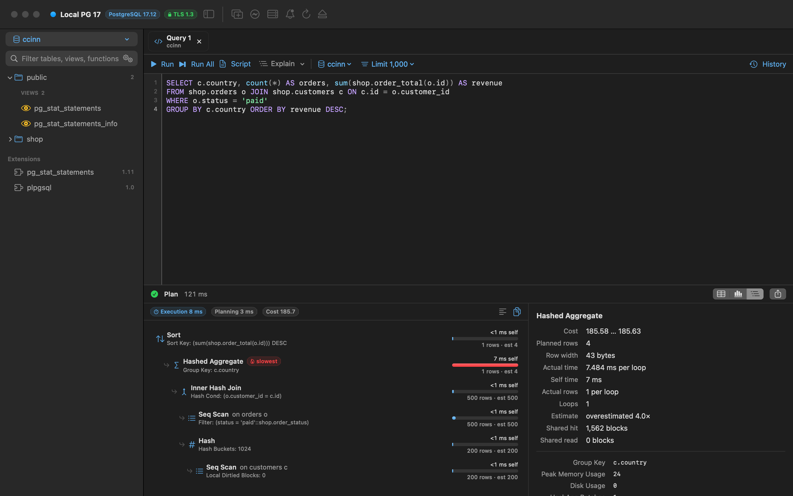
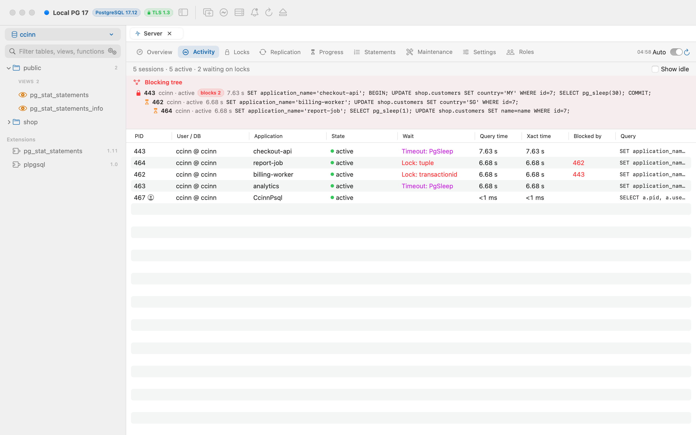
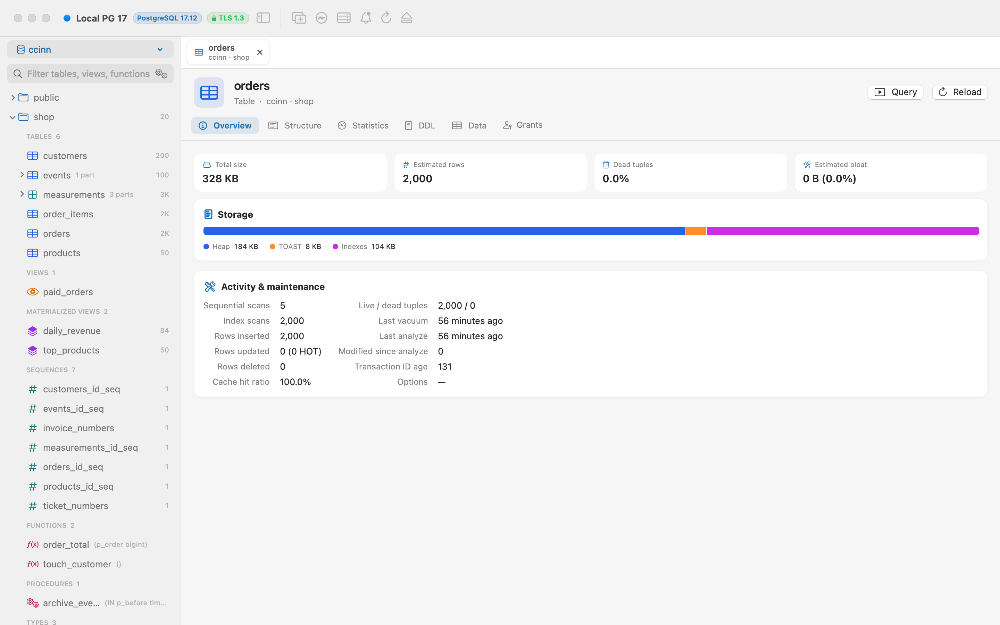
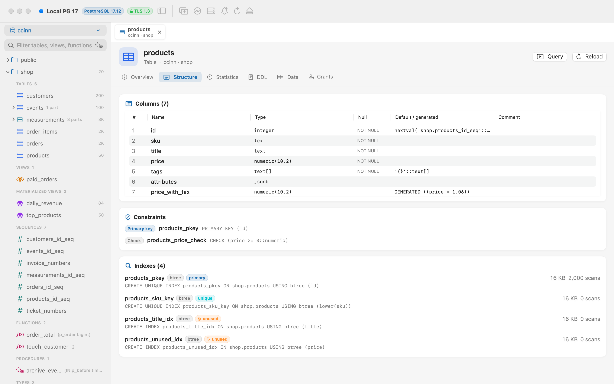
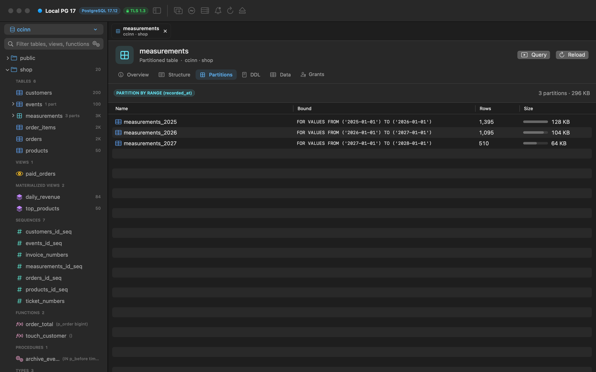
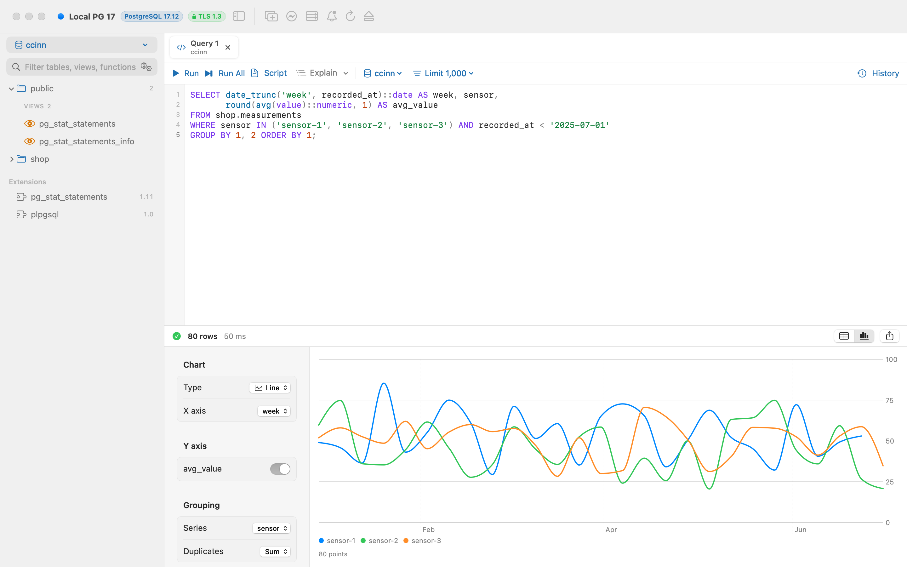
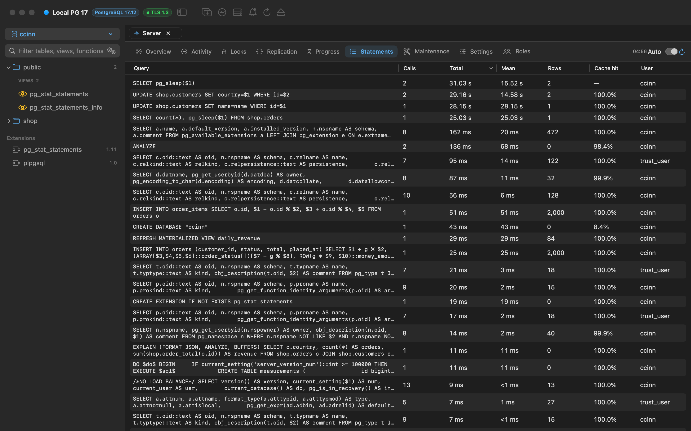
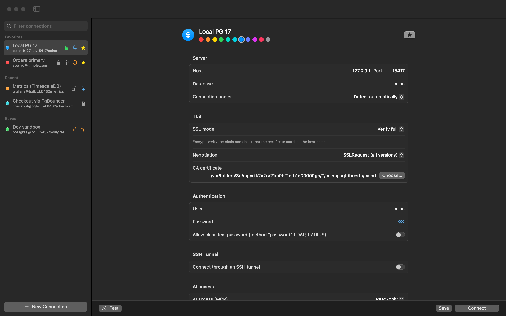

<p align="center">
  
</p>

<h1 align="center">CcinnPsql</h1>

<p align="center">
  <b>A fast, native macOS client built for PostgreSQL.</b><br>
  See who is blocking whom, which indexes are unused or bloated, how far replicas and slots lag, and what the planner really did, then turn any query into a chart.
</p>

<p align="center">
  <a href="https://github.com/whiteCcinn/ccinnpsql/actions/workflows/ci.yml"></a>
  <a href="https://github.com/whiteCcinn/ccinnpsql/releases/latest"></a>
  
  
  
  <a href="LICENSE"></a>
</p>

<p align="center">
  English · <a href="README.zh-CN.md">简体中文</a>
</p>

<p align="center">
  
</p>

## Why CcinnPsql?

Most PostgreSQL GUIs are cross-platform shells around a JDBC or libpq driver. They are good at listing tables and running queries, but the questions you ask every day while running PostgreSQL are left to hand-written catalog queries:

- Which session is holding the lock everyone else is waiting for?
- Which indexes are never used, and how much space do they waste?
- How bloated is this table, and when was it last vacuumed?
- Is that replication slot about to fill the disk?
- What did the planner actually do, and where did its row estimates go wrong?

CcinnPsql answers those in one click. It is a native SwiftUI/AppKit app with its own pure-Swift implementation of the PostgreSQL wire protocol: no Electron, no JDBC, no libpq, no bundled runtime and no telemetry.

## Features

- **Everything PostgreSQL has, organised.** A database switcher, then schemas with tables (partitioned tables with their partitions nested, inheritance children under their parent), views, materialized views, foreign tables, sequences, functions, procedures, aggregates, enums, domains, composite and range types, and installed extensions with available updates.
- **Table insights**
  - Columns with identity/generated definitions, collations and comments; constraints (primary, foreign, unique, check, exclusion) and triggers.
  - Indexes with size, scans, validity, **unused** flags and a **bloat estimate**.
  - Heap / TOAST / index size breakdown, live and dead tuples, sequential vs index scans, last (auto)vacuum and (auto)analyze, transaction-ID age and a table bloat estimate.
  - Partition key, bounds, sizes and rows; a **reconstructed CREATE statement** (PostgreSQL has no `SHOW CREATE TABLE`); grants; data preview.
  - Sequences with headroom (warns before a sequence runs out), functions with definition and volatility, enum labels, composite attributes and domain constraints.
  - **Materialized views**: refresh, or refresh **CONCURRENTLY** when a unique index allows it.
  - Extension awareness: **TimescaleDB** hypertables (chunks, compression, dimensions), **Citus** distributed and reference tables, **PostGIS** geometry/geography columns with SRIDs, **pg_stat_statements**.
- **Operations**
  - **Activity** from `pg_stat_activity` with wait events and durations, and a **blocking tree** built from `pg_blocking_pids`. Cancel or terminate a backend — guarded so the signal only fires on the server where the session was seen, even behind a load balancer or Pgpool.
  - **Locks**, **replication** (standbys with write/flush/replay lag, slots with retained WAL and `wal_status`, standby replay delay), **progress** of VACUUM, ANALYZE, CREATE INDEX, CLUSTER, COPY and base backups.
  - **Top statements** from `pg_stat_statements`, **settings** with source and pending restarts, **roles** with attributes and memberships, a server **overview** (connections, cache hit ratio, deadlocks, wraparound age, checkpoints) and **maintenance** candidates (dead tuples, freeze age, unused indexes).
- **SQL workbench**
  - PostgreSQL-aware highlighting (dollar quotes, `E''` strings, nested comments, `::` casts) and context-aware completion for schemas, tables, columns through aliases and CTEs, functions and types.
  - Run the current statement, the selection, every statement in turn, or the whole script as one batch with every result set. Plain `SELECT`s get an automatic `LIMIT`.
  - **Exact error underline** from the server's error position, plus SQLSTATE, detail, hint and context. Server **notices** (`RAISE NOTICE`) and **NOTIFY** messages are shown with the result.
  - Transaction state (in transaction / aborted) in the toolbar, **real cancellation** with PostgreSQL's CancelRequest, history with search.
  - **Visual EXPLAIN** (FORMAT JSON, optionally ANALYZE and BUFFERS): a plan tree with self time per node, the slowest node highlighted, row-estimate misses flagged and a detail inspector. EXPLAIN ANALYZE of a data-modifying statement runs inside a transaction that is rolled back, after confirmation.
  - Export as CSV, TSV, JSON, Markdown or INSERT statements, or stream a whole result to CSV with `COPY … TO STDOUT`.
  - **LISTEN / NOTIFY** panel: listen to channels on a dedicated connection and see notifications as they arrive.
- **Charts from any result**: line over time, bars by category, grouped bars, scatter and pie, with series and aggregation; large results are reduced to at most 2,000 points.
- **Connections done right**
  - `sslmode` disable / prefer / require / verify-ca / verify-full with your own CA file, TLS on the same socket after PostgreSQL's SSLRequest, and PostgreSQL 17 **direct TLS**. The header always shows whether the session is encrypted.
  - SCRAM-SHA-256 (the server's signature is verified), MD5, trust, and opt-in clear-text passwords.
  - SSH tunnels through the system `ssh`, secrets in the Keychain.
  - **PgBouncer and Pgpool-II aware**: transaction pooling is detected (or set per connection) and session features degrade with an explanation instead of silently breaking; the PgBouncer admin console works for `SHOW POOLS` and friends.
- **MCP server** so AI assistants can explore your databases and run read-only queries through the connections you allow (see below).

## Compatibility

| Server | Tested | Notes |
|---|---|---|
| PostgreSQL 9.6, 10, 11, 12, 13, 14, 15, 16, 17, 18 | ✅ full integration suite on every version | catalog queries adapt to the version (partitioning from 10, procedures from 11, progress views, `*_lsn` vs `*_location`, `pg_stat_checkpointer` on 17+) |
| PgBouncer 1.24 (transaction pooling) | ✅ | pooling detected; unnamed statements only; LISTEN disabled; admin console reports |
| Pgpool-II 4.6 | ✅ | detected; operations are routed to the primary with `/*NO LOAD BALANCE*/` |
| TimescaleDB 2.x, Citus 13, PostGIS 3.5 | ✅ single node | hypertables, distributed/reference tables, spatial columns |
| Managed services (RDS, Aurora, Cloud SQL, Azure, Supabase, Neon, …) | expected to work | features that need extra privileges degrade with an explanation |

Every catalog result is read **by column name**, so columns added in newer releases do not break the app. CcinnPsql runs on **macOS 14 Sonoma or later** (Apple silicon and Intel).

## Screenshots

| Activity with the blocking tree | Table overview: sizes, bloat, maintenance |
|---|---|
|  |  |
| **Columns, constraints and index usage** | **Partitions with bounds and sizes** |
|  |  |
| **Charts generated from a query** | **Top statements from pg_stat_statements** |
|  |  |
| **Connections with TLS, pooler and AI access** | **Visual EXPLAIN ANALYZE** |
|  |  |

## Installation

1. Download `CcinnPsql-<version>.dmg` (or the `.zip`) from the [latest release](https://github.com/whiteCcinn/ccinnpsql/releases/latest).
2. Open the disk image and drag **CcinnPsql** into **Applications**.
3. The app is ad-hoc signed but not notarized. The first time, right-click the app and choose **Open**, or run:

   ```bash
   xattr -dr com.apple.quarantine /Applications/CcinnPsql.app
   ```

Each release lists SHA-256 checksums in `SHA256SUMS.txt`.

## Quick start

1. Click **New Connection** and enter host, port (default **5432**), database, user and password. Pick an SSL mode (and a CA file for verify-ca / verify-full), and optionally an SSH tunnel.
2. Press **Test** (it reports the version, TLS and any pooler), then **Save & Connect**.
3. Expand a schema in the sidebar and pick a table to see its structure, statistics and DDL, open **Activity** in the toolbar, or press **⌘T** for a SQL editor.

Useful shortcuts:

| Shortcut | Action |
|---|---|
| **⌘↩** | Run the selection or the current statement |
| **⇧⌘↩** | Run all statements |
| **⌘E** / **⇧⌘E** | Explain / Explain Analyze (with buffers) |
| **⌘.** | Cancel the running statement |
| **⌃Space** | Show completions |
| **⌘/** | Comment or uncomment lines |
| **⌘T** | New query |
| **⌥⌘1** | Activity |
| **⇧⌘R** | Refresh schemas |
| **⇧⌘D** | Disconnect |

## MCP server: let AI query PostgreSQL

CcinnPsql has a built-in **Model Context Protocol** server. AI assistants such as **Claude Code**, **Codex**, **Claude Desktop** or Cursor can use it to explore your databases and run queries through your saved connections.

1. Open a connection in CcinnPsql and set **AI access (MCP)** to **Read-only** or **Read & write**. Connections are off by default.
2. Register the server. **Settings → MCP** shows these snippets with the right path, ready to copy:

   ```bash
   # Claude Code
   claude mcp add ccinnpsql -- /Applications/CcinnPsql.app/Contents/MacOS/CcinnPsql mcp
   ```

   ```toml
   # Codex (~/.codex/config.toml)
   [mcp_servers.ccinnpsql]
   command = "/Applications/CcinnPsql.app/Contents/MacOS/CcinnPsql"
   args = ["mcp"]
   ```

   ```json
   // Claude Desktop (claude_desktop_config.json) and other JSON-configured clients
   { "mcpServers": { "ccinnpsql": { "command": "/Applications/CcinnPsql.app/Contents/MacOS/CcinnPsql", "args": ["mcp"] } } }
   ```

3. Ask questions such as *"Who is blocking whom right now?"*, *"Which indexes in `shop` are unused and how big are they?"* or *"Why is this query slow?"*

**Tools**

| Group | Tools |
|---|---|
| Connections & server | `list_connections`, `server_info` (version, TLS, pooler, extensions, standby status) |
| Catalog | `list_databases`, `list_schemas`, `list_tables`, `describe_table` (columns, constraints, indexes, triggers, partitions, DDL) |
| Insights | `get_table_stats` (sizes, dead tuples, vacuum, bloat estimates, unused indexes), `get_activity` (sessions and blocking tree), `get_replication`, `get_top_statements` |
| SQL | `run_query`, `explain_query` (plan tree, optional ANALYZE), and `execute_statement` (read & write connections only) |

**Safety**

- Passwords stay in the Keychain and are never shown to the AI. Only connections you enabled are visible.
- Read-only is **enforced twice**. First, the app's own PostgreSQL lexer accepts only a single read: `SELECT`, `WITH … SELECT`, `VALUES`, `TABLE`, `SHOW` or `EXPLAIN` of those. It rejects data-modifying CTEs, `SELECT … INTO`, `COPY`, `DO`, `CALL`, transaction control, `SET`, row locks, functions with side effects (`pg_terminate_backend`, `set_config`, `pg_notify`, advisory locks, large objects, server file access, replication slots, `dblink`, …) and functions that run SQL passed as text (`ts_stat`, `query_to_xml`, `crosstab`, `pgr_*`, …). SQL inside string literals is checked again, recursively, whatever function receives it. Then the statement runs through the extended protocol inside `BEGIN TRANSACTION READ ONLY … ROLLBACK` with a `statement_timeout`, so PostgreSQL itself refuses any write the lexer could miss, and the session is reset (`DISCARD ALL`) before the connection is reused.
- Read-only means **no data or schema changes**. A function that already exists in your database can still do things a read-only transaction allows (such as signalling other sessions), and no SQL check can see inside it. For real isolation, give AI connections a dedicated low-privilege role — on PostgreSQL 14+: `CREATE ROLE ai_reader LOGIN PASSWORD '…'; GRANT pg_read_all_data, pg_monitor TO ai_reader;` (Settings → MCP shows this too).
- Results are capped at 1,000 rows (200 by default) and about 256 KB. Statements time out after 30 s by default (max 120 s).
- Cancelling a request in the AI client sends a CancelRequest to PostgreSQL.
- `--read-only` caps every connection at read-only; `--profile <name>` picks the default connection.
- Every call is logged, with passwords redacted, to `~/Library/Application Support/CcinnPsql/mcp-audit.jsonl` (0600).

## Building from source

Requirements: macOS 14+, Xcode 16 or later (Swift 6). No third-party dependencies.

```bash
git clone https://github.com/whiteCcinn/ccinnpsql.git
cd ccinnpsql
swift build                          # debug build
swift test --skip IntegrationTests   # unit tests
scripts/build-app.sh --open          # build dist/CcinnPsql.app and launch it
scripts/package-release.sh 1.0.0     # universal .app, .zip, .dmg and checksums in dist/
```

### Integration tests against real servers

Docker is required. `scripts/pg-up.sh` starts PostgreSQL containers (any of 9.6 and 10–18) with TLS, every authentication method and `pg_stat_statements`, and seeds a demo `shop` schema with partitions, inheritance, views, materialized views, sequences, functions, a procedure and custom types.

```bash
scripts/pg-up.sh 9.6 13 17 18
CCINNPSQL_IT=1 CCINNPSQL_IT_VERSIONS="9.6,13,17,18" swift test --filter IntegrationTests
scripts/pooler-up.sh      # PgBouncer (transaction pooling) and Pgpool-II, then CCINNPSQL_IT_POOLERS=1
scripts/extensions-up.sh  # TimescaleDB, Citus, PostGIS, then CCINNPSQL_IT_EXTENSIONS=1
scripts/pg-down.sh
```

See [CONTRIBUTING.md](CONTRIBUTING.md) for details (image sources, ports and the test-only PostGIS image).

## Architecture

```
CcinnPsql (SwiftUI/AppKit app, `mcp` subcommand)
 └─ CcinnPsqlKit    profiles & Keychain, PostgreSQL lexer/splitter/guard/redactor, completion, EXPLAIN model, charts, export, history, MCP
     └─ PostgresKit transport (TLS after SSLRequest, direct TLS, SSH), connection actor, CancelRequest, pools, sessions, listener,
                    pooler detection, version-aware catalog / insight / operation SQL
         └─ PostgresWire  protocol v3 messages, incremental decoder, MD5 & SCRAM-SHA-256, error fields, text & binary value decoding
```

- **Own protocol implementation.** Simple and extended query protocol, multiple result sets, notices, LISTEN/NOTIFY, COPY TO STDOUT, binary decoding that matches PostgreSQL's text output exactly (verified against every server version). Parsing is bounds-checked and fuzz-tested.
- **Race-free cancellation.** A CancelRequest goes to the resolved address of the session, only while that exact statement runs, and the next statement waits until the cancel has been delivered — a late cancel never hits the wrong statement.
- **One lexer for everything.** Highlighting, statement splitting, auto-limit, the read-only guard, redaction, error positions and completion share one PostgreSQL tokenizer, so they always agree.
- **Concurrency safety.** Connections, pools and sessions are Swift actors; the project builds in Swift 6 strict-concurrency mode. Sorting, chart preparation and export run off the main thread; result grids are virtualised.

## The ccinn series

Native macOS database and storage tools that share the same design, speed and care:

| App | What it is |
|---|---|
| [**CcinnMongo**](https://github.com/whiteCcinn/ccinnmongo) | Native MongoDB client for every server from 2.6 to 8.x, with the legacy `OP_QUERY` and the modern `OP_MSG` protocols. |
| [**CcinnStarRocks**](https://github.com/whiteCcinn/ccinnstarrocks) | Native StarRocks client. Covers partitions, tablets and skew, async and sync materialized views, running tasks, and SQL with completion and charts. |
| [**CcinnRedis**](https://github.com/whiteCcinn/ccinnredis) | Native Redis client for Redis 2.8 → 8.x and Valkey, in standalone, Sentinel, Cluster and proxy deployments. |
| [**CcinnBucket**](https://github.com/whiteCcinn/ccinnbucket) | Object storage browser for Amazon S3, S3-compatible services and Alibaba Cloud OSS. |
| [**CcinnMysql**](https://github.com/whiteCcinn/ccinnmysql) | Native MySQL, MariaDB and Percona client with InnoDB locks, replication, top statements and visual EXPLAIN. |
| **CcinnPsql** *(this project)* | Native PostgreSQL client for 9.6 → 18. Covers blocking trees, index and bloat insights, replication and slots, pg_stat_statements, visual EXPLAIN ANALYZE, PgBouncer/Pgpool awareness, and SQL with completion and charts. |
| [**CcinnClickHouse**](https://github.com/whiteCcinn/ccinnclickhouse) | Native ClickHouse client with parts, merges, mutations, replication and query-log analysis. |

## Contributors

- [whiteCcinn](https://github.com/whiteCcinn)

<a href="https://github.com/whiteCcinn/ccinnpsql/graphs/contributors"></a>

## Star history

[](https://star-history.com/#whiteCcinn/ccinnpsql&Date)

## Contributing

Contributions are welcome! Please read [CONTRIBUTING.md](CONTRIBUTING.md), and report security issues privately as described in [SECURITY.md](SECURITY.md).

## License

[MIT](LICENSE) © 2026 whiteCcinn. PostgreSQL is a registered trademark of the PostgreSQL Community Association of Canada; this project is not affiliated with or endorsed by the PostgreSQL Global Development Group. TimescaleDB, Citus and PostGIS are trademarks of their respective owners.
