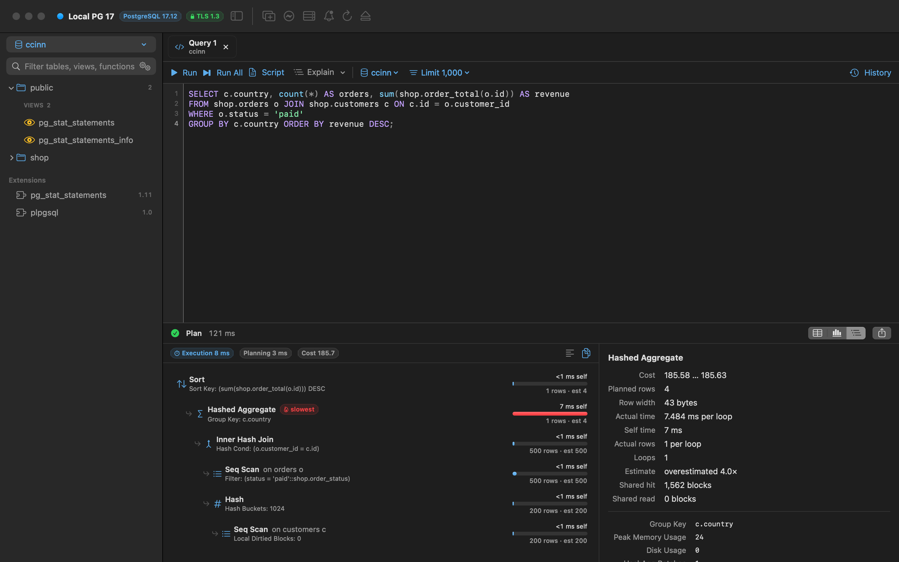
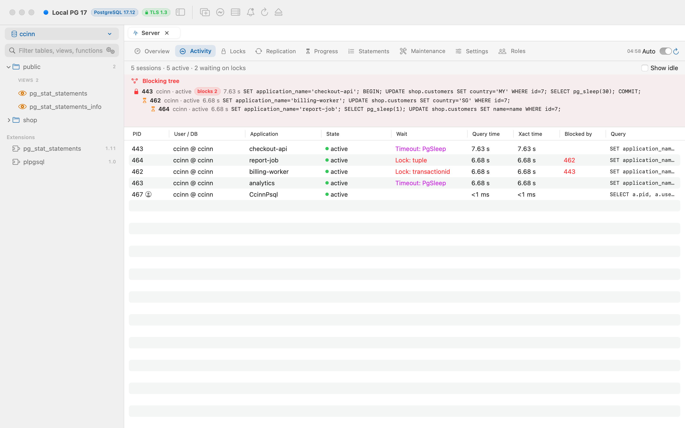
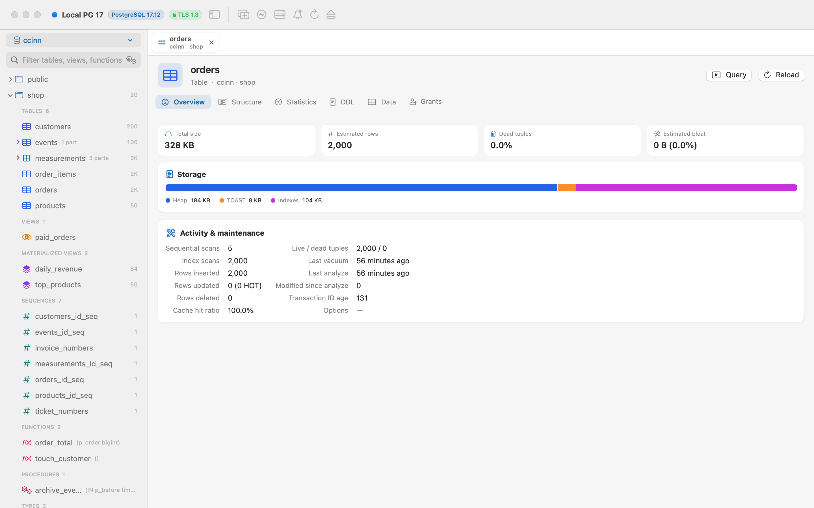
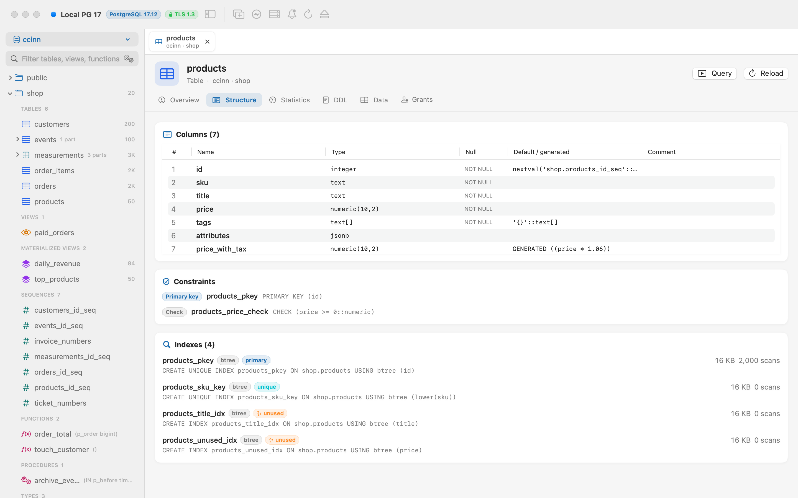
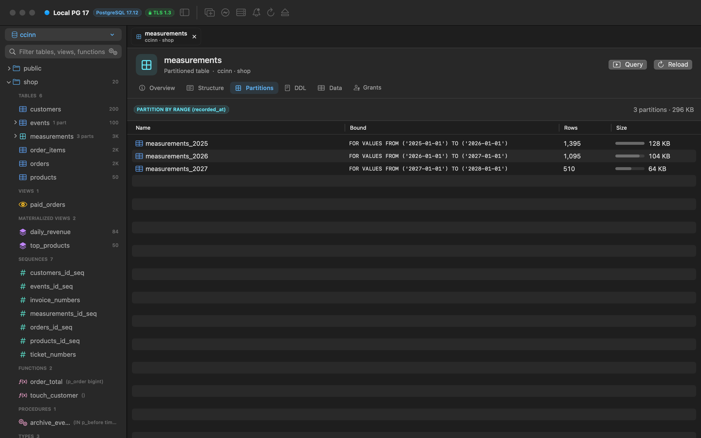
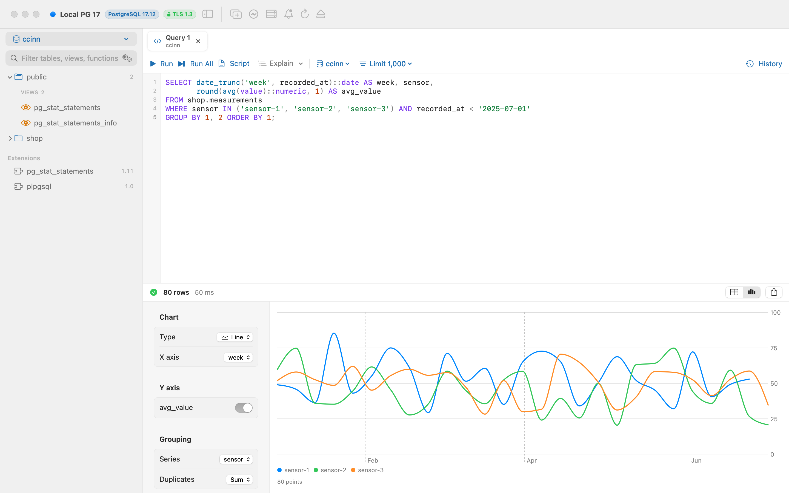
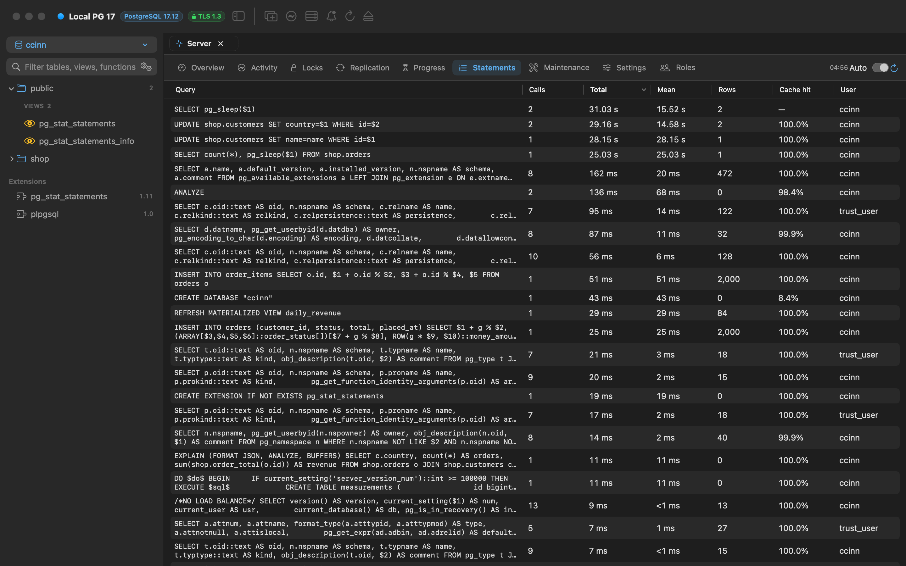
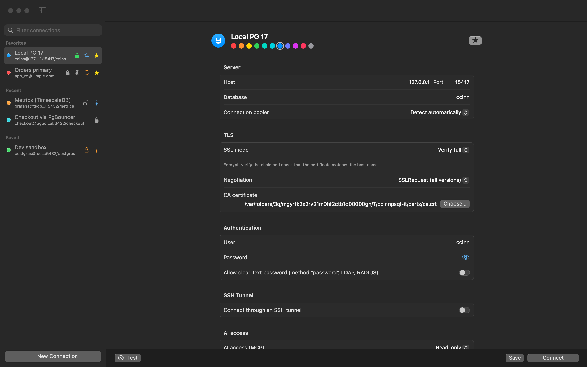

<p align="center">
  
</p>

<h1 align="center">CcinnPsql</h1>

<p align="center">
  <b>为 PostgreSQL 打造的快速、原生 macOS 客户端。</b><br>
  一眼看清谁在阻塞谁、哪些索引没被使用或已膨胀、备库和复制槽延迟多少、执行计划到底做了什么，并把任何查询结果变成图表。
</p>

<p align="center">
  <a href="https://github.com/whiteCcinn/ccinnpsql/actions/workflows/ci.yml"></a>
  <a href="https://github.com/whiteCcinn/ccinnpsql/releases/latest"></a>
  
  
  
  <a href="LICENSE"></a>
</p>

<p align="center">
  <a href="README.md">English</a> · 简体中文
</p>

<p align="center">
  
</p>

## 为什么选择 CcinnPsql？

大多数 PostgreSQL 图形客户端是包着 JDBC 或 libpq 驱动的跨平台外壳，擅长列出表和执行查询，但日常运维 PostgreSQL 时真正要问的问题，仍然得手写系统表查询：

- 谁持有了所有人都在等的那把锁？
- 哪些索引从未被使用，浪费了多少空间？
- 这张表膨胀了多少，上次 VACUUM 是什么时候？
- 那个复制槽是不是快把磁盘撑满了？
- 优化器实际做了什么，行数估算在哪里出了偏差？

CcinnPsql 一键回答这些问题。它是原生 SwiftUI/AppKit 应用，自带纯 Swift 实现的 PostgreSQL 线协议：没有 Electron、没有 JDBC、没有 libpq、不捆绑运行时，也没有任何遥测。

## 功能

- **PostgreSQL 的一切，井然有序。** 数据库切换器，下面是 schema：表（分区表下嵌套其分区，继承子表挂在父表下）、视图、物化视图、外部表、序列、函数、存储过程、聚合函数、枚举、域、复合类型与范围类型，以及已安装扩展和可升级版本。
- **表洞察**
  - 列（含 identity / generated 定义、排序规则、注释）；约束（主键、外键、唯一、检查、排他）与触发器。
  - 索引的大小、扫描次数、有效性，**未使用**标记与**膨胀估算**。
  - 堆 / TOAST / 索引的空间拆分，活跃与死元组，顺序扫描与索引扫描，最近一次（自动）VACUUM 与（自动）ANALYZE，事务 ID 年龄，以及表膨胀估算。
  - 分区键、分区边界、大小与行数；**重建的 CREATE 语句**（PostgreSQL 没有 `SHOW CREATE TABLE`）；权限；数据预览。
  - 序列余量（快耗尽时提醒）、函数定义与易变性、枚举值、复合类型属性与域约束。
  - **物化视图**：刷新，或在具备唯一索引时 **CONCURRENTLY** 刷新。
  - 扩展感知：**TimescaleDB** 超表（chunk、压缩、维度）、**Citus** 分布表与引用表、**PostGIS** geometry/geography 列及 SRID、**pg_stat_statements**。
- **运维**
  - 基于 `pg_stat_activity` 的**会话活动**（等待事件与时长），以及由 `pg_blocking_pids` 构建的**阻塞树**。取消或终止后端进程时会校验节点身份，确保信号只发送到观察到该会话的那台服务器——即使经过负载均衡或 Pgpool。
  - **锁**、**复制**（备库的 write/flush/replay 延迟、复制槽保留的 WAL 与 `wal_status`、备库回放延迟）、VACUUM / ANALYZE / CREATE INDEX / CLUSTER / COPY / 基础备份的**进度**。
  - 来自 `pg_stat_statements` 的 **Top SQL**、带来源与待重启标记的**参数设置**、带属性与成员关系的**角色**、服务器**概览**（连接数、缓存命中率、死锁、回卷年龄、检查点）以及**维护**候选（死元组、冻结年龄、未使用索引）。
- **SQL 工作台**
  - 理解 PostgreSQL 语法的高亮（美元引号、`E''` 字符串、嵌套注释、`::` 类型转换）与上下文补全：schema、表、经别名和 CTE 推断的列、函数与类型。
  - 执行当前语句、选中内容、逐条执行全部语句，或把整段脚本作为一个批次执行并展示每个结果集。普通 `SELECT` 自动加 `LIMIT`。
  - **精确、实时的错误标记**：
    - 根据服务端返回的错误位置精确标出出错的词；没有位置时，则标出错误信息中提到的对象。
    - `DO` 块和函数体内部的错误同样能定位；`EXPLAIN`、自动 `LIMIT` 和整段脚本执行时，标记都能准确映射回编辑器中的原文。
    - 错误信息和 PostgreSQL 的 **HINT** 直接显示在该行末尾，编辑器下方的状态栏会显示行号、列号，并可切换上一个 / 下一个问题。
    - 标记会随编辑移动，修改出错语句后自动消失。
    - 结果区显示 SQLSTATE 及其条件名、详情与上下文。
  - 输入时即时提示未闭合的字符串、带引号的标识符、美元引号、（嵌套的）块注释、圆括号和方括号，无需连接服务器。
  - **格式化 SQL**（Format SQL，⌥⌘L）：整理选中内容或整段脚本，一次 ⌘Z 即可撤销：
    - 子句各占一行，列表每项一行，`AND`/`OR` 条件分行；
    - 子查询和 CTE 缩进，CASE 拆成多行。

    只调整空白和关键字的大小写（保留字，以及按所在位置能确定是关键字的词）。名称（包括拼写和关键字相同的名称，如 `rows`、`t.from`）、字符串、美元引号包裹的函数体、带引号的标识符和注释保持原样，原本连在一起写的内容也不会被拆开。选区会扩展到完整的词法单元，换行符保持原样。应用前会按所支持的各个 PostgreSQL 版本的词法规则逐个词法单元校验结果；无法应用（或输入法仍在组字）时不会替换文本，并在状态提示中说明原因。关键字大小写和缩进可在 **设置 → 通用** 中调整。
  - 服务端**通知**（`RAISE NOTICE`）和 **NOTIFY** 消息随结果一起展示。
  - 工具栏显示事务状态（事务中 / 已中止），用 PostgreSQL 的 CancelRequest **真正取消**语句，历史记录可搜索。
  - **可视化 EXPLAIN**（FORMAT JSON，可选 ANALYZE 与 BUFFERS）：计划树显示每个节点的自身耗时，高亮最慢节点、标出行数估算偏差，并提供节点详情面板。对修改数据的语句执行 EXPLAIN ANALYZE 时，会在确认后放进一个最终回滚的事务里执行。
  - 导出为 CSV、TSV、JSON、Markdown 或 INSERT 语句，或用 `COPY … TO STDOUT` 将完整结果流式导出为 CSV。
  - **LISTEN / NOTIFY** 面板：在独立连接上监听频道，通知到达即显示。
- **任意结果一键成图**：时间折线、分类柱状、分组柱状、散点与饼图，支持系列与聚合；大结果集最多压缩到 2,000 个点。
- **连接做到位**
  - **多窗口**，每个窗口使用各自独立的连接：File ▸ New CcinnPsql Window（⌘N）打开新窗口；**New Window with This Connection**（⇧⌘N，也可点工具栏的 New Window 按钮）用当前连接再开一个窗口；也可以在已保存连接的右键菜单中选择 **Open in New Window**。关闭某个窗口只会断开该窗口的连接。
  - `sslmode` disable / prefer / require / verify-ca / verify-full，可指定自己的 CA 文件；在 PostgreSQL 的 SSLRequest 之后于同一连接上升级 TLS，并支持 PostgreSQL 17 的**直接 TLS**。顶栏始终显示会话是否加密。
  - SCRAM-SHA-256（校验服务端签名）、MD5、trust，以及需手动开启的明文密码。
  - 通过系统 `ssh` 建立 SSH 隧道，密码保存在钥匙串中。
  - **感知 PgBouncer 与 Pgpool-II**：自动检测事务池模式（也可在连接中指定），会话级功能会说明原因并降级，而不是悄悄失效；PgBouncer 管理控制台可执行 `SHOW POOLS` 等命令。
- **MCP 服务**：让 AI 助手通过你授权的连接浏览数据库、执行只读查询（见下文）。

## 兼容性

| 服务端 | 测试情况 | 说明 |
|---|---|---|
| PostgreSQL 9.6、10、11、12、13、14、15、16、17、18 | ✅ 每个版本都跑完整集成测试 | 系统表查询按版本自适应（10 起的分区、11 起的存储过程、进度视图、`*_lsn` 与 `*_location`、17+ 的 `pg_stat_checkpointer`） |
| PgBouncer 1.24（事务池） | ✅ | 自动检测池模式；仅使用匿名语句；禁用 LISTEN；管理控制台报表 |
| Pgpool-II 4.6 | ✅ | 自动检测；运维操作通过 `/*NO LOAD BALANCE*/` 路由到主库 |
| TimescaleDB 2.x、Citus 13、PostGIS 3.5 | ✅ 单节点 | 超表、分布表/引用表、空间列 |
| 云托管服务（RDS、Aurora、Cloud SQL、Azure、Supabase、Neon …） | 预期可用 | 需要额外权限的功能会说明原因并降级 |

所有系统表结果都**按列名读取**，新版本增加的列不会让应用出错。CcinnPsql 运行于 **macOS 14 Sonoma 或更高版本**（Apple 芯片与 Intel）。

## 截图

| 带阻塞树的会话活动 | 表概览：空间、膨胀、维护 |
|---|---|
|  |  |
| **列、约束与索引使用情况** | **分区边界与大小** |
|  |  |
| **由查询生成的图表** | **pg_stat_statements 的 Top SQL** |
|  |  |
| **带 TLS、连接池与 AI 访问设置的连接** | **可视化 EXPLAIN ANALYZE** |
|  |  |

## 安装

1. 从 [最新发布](https://github.com/whiteCcinn/ccinnpsql/releases/latest) 下载 `CcinnPsql-<版本>.dmg`（或 `.zip`）。
2. 打开磁盘映像，把 **CcinnPsql** 拖进 **应用程序**。
3. 应用采用 ad-hoc 签名但未经公证。首次打开时请右键应用选择 **打开**，或执行：

   ```bash
   xattr -dr com.apple.quarantine /Applications/CcinnPsql.app
   ```

每个发布都在 `SHA256SUMS.txt` 中列出 SHA-256 校验和。

### 更新

选择 **CcinnPsql → 检查更新…（Check for Updates…）**。如果有新版本，CcinnPsql 会显示更新内容。**下载并打开（Download & Open）** 会把磁盘映像保存到“下载”文件夹，按该版本的 `SHA256SUMS.txt` 校验后再打开。退出 CcinnPsql，然后把新版本拖到 **应用程序** 文件夹即可。

CcinnPsql 每天也会在后台自动检查一次，可以在 **设置 → 通用 → 更新** 中关闭。检查只访问 GitHub 的公开 Releases API，也可以选择 **跳过此版本（Skip This Version）**。

项目主页、发布说明和问题反馈入口也在 **帮助** 菜单和“关于”窗口中。

## 快速上手

1. 点击 **New Connection**，填写主机、端口（默认 **5432**）、数据库、用户与密码。选择 SSL 模式（verify-ca / verify-full 可指定 CA 文件），需要时配置 SSH 隧道。
2. 点击 **Test**（会显示版本、TLS 与连接池情况），然后 **Save & Connect**。
3. 在侧栏展开 schema，选择一张表查看结构、统计与 DDL；点击工具栏的 **Activity** 查看会话；或按 **⌘T** 打开 SQL 编辑器。

常用快捷键：

| 快捷键 | 作用 |
|---|---|
| **⌘↩** | 执行选中内容或当前语句 |
| **⇧⌘↩** | 执行全部语句 |
| **⌘E** / **⇧⌘E** | Explain / Explain Analyze（含 buffers） |
| **⌘.** | 取消正在执行的语句 |
| **⌃Space** | 显示补全 |
| **⌘/** | 注释或取消注释 |
| **⌥⌘L** | 格式化选中内容或整段脚本 |
| **⌘T** | 新建查询 |
| **⌘N** | 新建窗口（连接其他服务器，或同一台服务器） |
| **⇧⌘N** | 用当前连接新建窗口 |
| **⌥⌘1** | 会话活动 |
| **⇧⌘R** | 刷新 schema |
| **⇧⌘D** | 断开连接 |

## MCP 服务：让 AI 查询 PostgreSQL

CcinnPsql 内置 **Model Context Protocol** 服务。**Claude Code**、**Codex**、**Claude Desktop**、Cursor 等 AI 助手可以通过它，使用你保存的连接浏览数据库并执行查询。

1. 在 CcinnPsql 中打开某个连接，把 **AI access (MCP)** 设为 **Read-only** 或 **Read & write**。默认全部关闭。
2. 注册服务。**Settings → MCP** 会给出带正确路径、可直接复制的配置：

   ```bash
   # Claude Code
   claude mcp add ccinnpsql -- /Applications/CcinnPsql.app/Contents/MacOS/CcinnPsql mcp
   ```

   ```toml
   # Codex（~/.codex/config.toml）
   [mcp_servers.ccinnpsql]
   command = "/Applications/CcinnPsql.app/Contents/MacOS/CcinnPsql"
   args = ["mcp"]
   ```

   ```json
   // Claude Desktop（claude_desktop_config.json）及其他使用 JSON 配置的客户端
   { "mcpServers": { "ccinnpsql": { "command": "/Applications/CcinnPsql.app/Contents/MacOS/CcinnPsql", "args": ["mcp"] } } }
   ```

3. 然后就可以提问，例如 *“现在谁在阻塞谁？”*、*“`shop` 里哪些索引没被使用，各占多大？”* 或 *“这条查询为什么慢？”*

**工具**

| 分组 | 工具 |
|---|---|
| 连接与服务器 | `list_connections`、`server_info`（版本、TLS、连接池、扩展、是否备库）、`get_settings`（内置参数，可按名称过滤；从不包含 `name.with.dot` 这类自定义参数）、`list_roles`（角色属性（含 inherit）与成员关系；从不包含角色设置、密码、密码过期时间和注释） |
| 目录 | `list_databases`、`list_schemas`、`list_tables`、`describe_table`（列、约束、索引、触发器、分区、DDL） |
| 洞察 | `get_table_stats`（空间、死元组、VACUUM、膨胀估算、未使用索引）、`get_activity`（会话与阻塞树）、`get_replication`、`get_top_statements` |
| SQL | `run_query`、`explain_query`（计划树，可选 ANALYZE），以及仅在读写连接上提供的 `execute_statement` |

**安全**

- 密码保存在钥匙串中，从不展示给 AI；只有你启用的连接对 AI 可见。
- 只读**双重保障**。第一层，应用自带的 PostgreSQL 词法分析器只接受单条只读语句：`SELECT`、`WITH … SELECT`、`VALUES`、`TABLE`、`SHOW`，或对它们的 `EXPLAIN`。它会拒绝修改数据的 CTE、`SELECT … INTO`、`COPY`、`DO`、`CALL`、事务控制、`SET`、行锁、有副作用的函数（`pg_terminate_backend`、`set_config`、`pg_notify`、advisory 锁、大对象、服务器文件访问、复制槽、`dblink` 等），只读事务挡不住的索引维护（`brin_summarize_new_values`、`gin_clean_pending_list` 等），把文本当作 SQL 执行的函数（`ts_stat`、`query_to_xml`、`crosstab`、`pgr_*`、pgTAP、orafce 的 `dbms_sql`、`hypopg_create_index` 等；其他扩展可能还有更多），网络请求（pg_net、pgsql-http），其他会话 SQL 的视图，以及可能存有机密的设置（`pg_roles`、`pg_settings`、`SHOW ALL`、`myapp.api_key` 这类自定义参数；内置参数仍可用 `get_settings`、`SHOW name`（仅一个不加引号的普通参数名）或 `current_setting('name')` 读取，角色可用 `list_roles` 查看）。任何语句中的 Unicode 转义名称（`U&"…"`、`UESCAPE`）都会被拒绝。字符串字面量里的 SQL 无论传给哪个函数，都会被递归地再检查一遍。第二层，语句会通过扩展查询协议在 `BEGIN TRANSACTION READ ONLY … ROLLBACK` 中执行，并设置 `statement_timeout`；即使词法检查有遗漏，PostgreSQL 自身也会拒绝写入。每次调用结束、连接归还连接池之前，会话都会被重置（`DISCARD ALL`）。
- 只读的含义是**不修改数据和表结构**。数据库中已有的函数仍可能做只读事务允许的事情（例如向其他会话发送信号），任何 SQL 检查都看不到函数内部。若要真正隔离，请为 AI 连接使用专门的低权限角色——PostgreSQL 14+：`CREATE ROLE ai_reader LOGIN PASSWORD '…'; GRANT pg_read_all_data TO ai_reader;`（设置 → MCP 面板中也有提示）。当前角色可执行的、`pg_catalog` 和少数已审查扩展之外的不受信任语言函数（internal、C、plpython3u 等）会随每次结果列出，按名称直接调用会被拒绝。这只是尽力而为：视图、运算符、类型转换、默认值和行级安全策略也会调用函数，所以真正的控制是不给该角色这些函数的 EXECUTE 权限。可读的 `postgres_fdw` 外部表也会列出。如果连接的 `search_path` 包含 orafce 的模式（`dbms_sql`、`dbms_pipe`、`dbms_alert`、`utl_file`），该连接会被拒绝，因为 `open_cursor()` 这类不带模式名的调用会落到这些函数上；CcinnPsql 不会改写你的 search_path。名称中不能出现大小写映射会变成 ASCII 字母的字符（`İ`、`ı`、`ſ`、`ß`、`K`、`fi` 等：土耳其语数据库会把 `PG_SETTİNGS` 折叠成 `pg_settings`）；在单字节编码的数据库（LATIN1、LATIN5、WIN1254、SQL_ASCII 等）里，服务器会按 locale 折叠名称中的非 ASCII 字母，因此不加引号的名称必须是 ASCII——请加引号或改用 ASCII。
- **拒绝高权限角色。** 每次只读调用之前，CcinnPsql 都会在该调用自己的事务内检查连接所用的角色。超级用户，或（经由任意成员关系链）属于或可以成为 `pg_execute_server_program`、`pg_read_server_files`、`pg_write_server_files` 成员的角色，可以通过任何函数或运行时拼出的 SQL 在服务器上执行程序、读写服务器文件；`pg_read_all_stats`、`pg_read_all_settings`、`pg_monitor` 的成员可以读取所有会话的 SQL 和全部设置。任何只读检查都无法阻止这些。因此，除非你在 设置 → MCP 中为该连接打开 **Allow AI read-only access on a privileged role**，只读访问会拒绝这类角色；该处的 **Check Role** 可以查看角色能拿到哪些权限。由高权限角色拥有、且当前角色可调用的 `SECURITY DEFINER` 函数，以及当前角色可读、读取时会执行服务器程序或读取服务器文件的外部表（file_fdw 的 `program` / `filename`），不会被拒绝（扩展常会安装此类函数），而是在每次结果（包括出错时）和 设置 → MCP 中列出：检查看不到函数内部，它们仍属于已接受的风险。
- 结果最多 1,000 行（默认 200 行）、约 256 KB；语句默认 30 秒超时（最长 120 秒）。
- 在 AI 客户端取消请求时，会向 PostgreSQL 发送 CancelRequest。
- `--read-only` 把所有连接限制为只读；`--profile <名称>` 指定默认连接。
- 每次调用都会写入 `~/Library/Application Support/CcinnPsql/mcp-audit.jsonl`（权限 0600，密码已脱敏）。

## 从源码构建

要求：macOS 14+，Xcode 16 或更高（Swift 6）。没有任何第三方依赖。

```bash
git clone https://github.com/whiteCcinn/ccinnpsql.git
cd ccinnpsql
swift build                          # Debug 构建
swift test --skip IntegrationTests   # 单元测试
scripts/build-app.sh --open          # 构建 dist/CcinnPsql.app 并启动
scripts/package-release.sh 1.0.0     # 在 dist/ 生成通用二进制 .app、.zip、.dmg 与校验和
```

### 针对真实服务器的集成测试

需要 Docker。`scripts/pg-up.sh` 会启动 PostgreSQL 容器（9.6 与 10–18 任选），开启 TLS、各种认证方式与 `pg_stat_statements`，并灌入演示用的 `shop` schema（分区、继承、视图、物化视图、序列、函数、存储过程与自定义类型）。

```bash
scripts/pg-up.sh 9.6 13 17 18
CCINNPSQL_IT=1 CCINNPSQL_IT_VERSIONS="9.6,13,17,18" swift test --filter IntegrationTests
scripts/pooler-up.sh      # PgBouncer（事务池）与 Pgpool-II，然后设置 CCINNPSQL_IT_POOLERS=1
scripts/extensions-up.sh  # TimescaleDB、Citus、PostGIS，然后设置 CCINNPSQL_IT_EXTENSIONS=1
scripts/pg-down.sh
```

镜像来源、端口以及仅用于测试的 PostGIS 镜像等细节见 [CONTRIBUTING.md](CONTRIBUTING.md)。

## 架构

```
CcinnPsql（SwiftUI/AppKit 应用，`mcp` 子命令）
 └─ CcinnPsqlKit    连接配置与钥匙串、PostgreSQL 词法/分句/只读守卫/脱敏、补全、EXPLAIN 模型、图表、导出、历史、MCP
     └─ PostgresKit 传输层（SSLRequest 后的 TLS、直接 TLS、SSH）、连接 actor、CancelRequest、连接池、会话、监听器、
                    连接池代理检测、按版本自适应的目录 / 洞察 / 运维 SQL
         └─ PostgresWire  协议 v3 消息、增量解码器、MD5 与 SCRAM-SHA-256、错误字段、文本与二进制取值解码
```

- **自研协议实现。** 简单与扩展查询协议、多结果集、通知、LISTEN/NOTIFY、COPY TO STDOUT，以及与 PostgreSQL 文本输出完全一致的二进制解码（已在所有服务端版本上验证）。解析全程边界检查并经过模糊测试。
- **无竞态的取消。** CancelRequest 发往会话实际连接的解析地址，且只在那条语句仍在执行时发送；下一条语句会等到取消请求送达后才开始，迟到的取消永远不会误杀后续语句。
- **一个词法器贯穿始终。** 高亮、分句、自动 LIMIT、只读守卫、脱敏、错误定位与补全共用同一个 PostgreSQL 词法器，结果始终一致。
- **并发安全。** 连接、连接池与会话都是 Swift actor，项目在 Swift 6 严格并发模式下编译。排序、图表准备与导出都在主线程之外执行，结果表格虚拟化渲染。

## ccinn 系列

设计、速度与用心一脉相承的原生 macOS 数据库与存储工具：

| 应用 | 简介 |
|---|---|
| [**CcinnMongo**](https://github.com/whiteCcinn/ccinnmongo) | 原生 MongoDB 客户端，支持 2.6 到 8.x 的所有服务端，兼容旧的 `OP_QUERY` 与新的 `OP_MSG` 协议。 |
| [**CcinnStarRocks**](https://github.com/whiteCcinn/ccinnstarrocks) | 原生 StarRocks 客户端，涵盖分区、tablet 与数据倾斜、同步与异步物化视图、运行中的任务，以及带补全和图表的 SQL。 |
| [**CcinnRedis**](https://github.com/whiteCcinn/ccinnredis) | 原生 Redis 客户端，支持 Redis 2.8 → 8.x 与 Valkey，覆盖单机、Sentinel、Cluster 与代理部署。 |
| [**CcinnBucket**](https://github.com/whiteCcinn/ccinnbucket) | 对象存储浏览器，支持 Amazon S3、S3 兼容服务与阿里云 OSS。 |
| [**CcinnMysql**](https://github.com/whiteCcinn/ccinnmysql) | 原生 MySQL、MariaDB 与 Percona 客户端，提供 InnoDB 锁、复制、Top SQL 与可视化 EXPLAIN。 |
| **CcinnPsql** *（本项目）* | 原生 PostgreSQL 客户端，支持 9.6 → 18，涵盖阻塞树、索引与膨胀洞察、复制与复制槽、pg_stat_statements、可视化 EXPLAIN ANALYZE、PgBouncer/Pgpool 感知，以及带补全和图表的 SQL。 |
| [**CcinnClickHouse**](https://github.com/whiteCcinn/ccinnclickhouse) | 原生 ClickHouse 客户端，提供 parts、merges、mutations、复制与查询日志分析。 |

## 贡献者

- [whiteCcinn](https://github.com/whiteCcinn)

<a href="https://github.com/whiteCcinn/ccinnpsql/graphs/contributors"></a>

## Star 历史

[](https://star-history.com/#whiteCcinn/ccinnpsql&Date)

## 参与贡献

欢迎贡献！请先阅读 [CONTRIBUTING.md](CONTRIBUTING.md)，安全问题请按 [SECURITY.md](SECURITY.md) 私下报告。

## 许可证

[MIT](LICENSE) © 2026 whiteCcinn。PostgreSQL 是加拿大 PostgreSQL 社区协会的注册商标；本项目与 PostgreSQL 全球开发组无关，也未获其认可。TimescaleDB、Citus 与 PostGIS 是各自所有者的商标。
